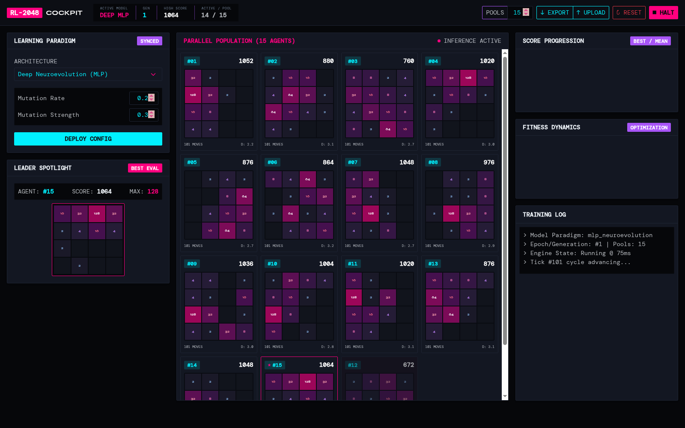
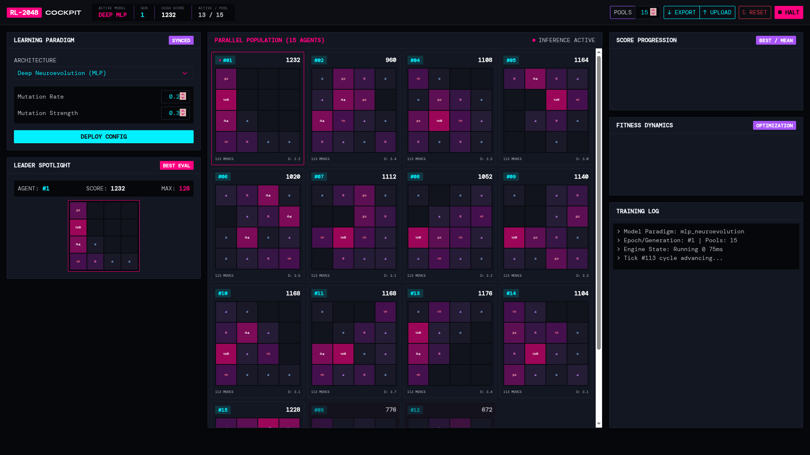

# 🎮 AI Plays 2048 — Evolutionary Neural Agent Arena

[](https://developer.mozilla.org/)
[](https://www.python.org/)
[](https://vitejs.dev/)
[](https://developer.mozilla.org/en-US/docs/Web/API/WebSockets_API)
[](https://sass-lang.com/)

A real-time browser arena where populations of autonomous neural heuristic agents evolve game-playing strategies to solve 2048. Features real-time state telemetry, evolutionary breeding, cross-over mutations, and concurrent board rendering.

---

## 📸 Screenshots & Architecture

<p align="center">
  
  
</p>

---

## ✨ Key Features

- **Concurrent Multi-Agent Simulation:** Run and visualize up to dozens of autonomous 2048 agent games in parallel in real time.
- **Population-Based Genetic Algorithm:**
  - Evaluates heuristic board fitness models across generations.
  - Scores six distinct board evaluation features:
    - Empty board cell capacity
    - Highest tile value
    - Monotonicity (ordered rows/columns)
    - Smoothness (neighbor tile delta penalty)
    - Corner anchoring of maximum tiles
    - Merge opportunity potential
- **Dynamic Mutation & Crossover:** Top-performing policies survive each generation as elite seeds; remaining slots are populated through genetic crossover and Gaussian mutations.
- **Bi-Directional WebSocket Bridge:** Python engine manages game rules, policy weights, generation state, and reward functions; front-end renders games, score charts, and generational telemetry.
- **Persistence Across Epochs:** Failed games stay rendered in spectator state until the entire cohort completes the generation epoch.

---

## 🏗 Architecture & Stack

```text
├── src/
│   ├── js/             # Real-time WebSocket client, chart renderers & board animators
│   └── scss/           # Dark mode arena layout and responsive grid styles
├── python/
│   ├── evolve_agent.py # Heuristic vector weights, board evaluator & genetic mutation engine
│   └── server.py       # High-throughput asynchronous WebSocket game server
├── demoPics/           # High-resolution application screenshots
├── index.html          # Browser workbench entrypoint
└── package.json        # Node.js dev scripts and build configuration
```

---

## 🚀 Quick Start

### 1. Install Node Dependencies
```bash
npm install
```

### 2. Start the Python Evolutionary Server
```bash
npm run python
```

### 3. Launch Vite Development Server
```bash
npm run dev
```

Open `http://localhost:5173` in your browser. Configure your desired population size in the arena header and select **Apply** to begin generational learning.

---

## 🛠 Tech Stack

- **Frontend:** Vanilla JavaScript (ES Modules), HTML5 Canvas, SCSS, Vite
- **Backend Simulation:** Python 3.10+, WebSockets, NumPy
- **Algorithm:** Genetic Algorithm (GA), Heuristic Vector Optimization, Reward Shaping
